<picture>
  <source media="(prefers-color-scheme: dark)" srcset="stage-dark.svg">
  <source media="(prefers-color-scheme: light)" srcset="stage-light.svg">
  
</picture>

<h3 align="center">Give your AI agent a face on your Mac desktop.</h3>

That’s the angel. It comes with the app, and it has been peeking over that terminal since you got here. 
Residents pay no rent and do no work. Your AI agent does the work, and speaks or asks through one.

Make your own from a sentence, or bring a picture you love. Pick one up and toss it; it won’t mind. 
They never look at your screen or your keys. Mostly they just sit there, which is the whole point.

<b>Free · Coming soon to the Mac App Store</b>

<a href="https://pixling.app"><b>pixling.app</b></a> &nbsp;·&nbsp;
<a href="https://github.com/pixling/pixling">Watch for the release</a> &nbsp;·&nbsp;
<a href="https://github.com/pixling/pixling/discussions">Ideas and questions</a> &nbsp;·&nbsp;
<a href="mailto:support@pixling.app">support@pixling.app</a>

---

To hear when Pixling is out, open <a href="https://github.com/pixling/pixling">pixling/pixling</a> and choose <b>Watch → Custom → Releases</b>. Bug reports open there with the app. The app’s source code is not here: Pixling is proprietary, <b>all rights reserved</b>. Do not post billing, refund or transaction details publicly.
